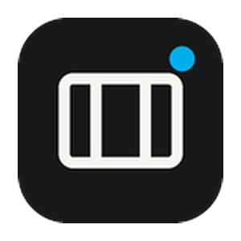
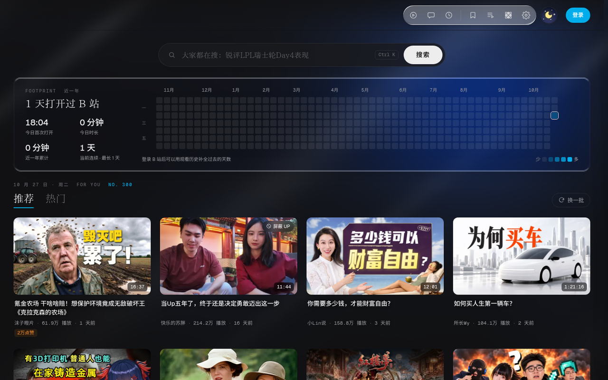
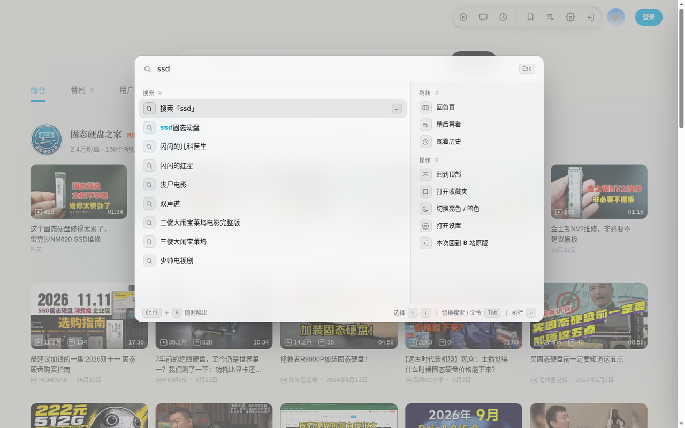
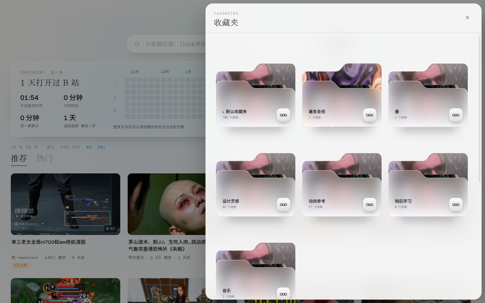

<div align="center">



<h1>MARGIN</h1>

<p><strong>A clearer way to browse Bilibili.</strong></p>
<p>Clean layouts, liquid glass controls and animated backgrounds, with the native playback experience.</p>
<p>给 B 站换一个更清晰的界面。编辑式排版，保留熟悉的原生播放体验。</p>

<p>
  <a href="https://github.com/jiuyang5354/bilibili-margin/releases/latest"></a>
  
  
  <a href="LICENSE"></a>
</p>

<p>
  <a href="https://github.com/jiuyang5354/bilibili-margin/releases/latest">Download</a> ·
  <a href="#quick-start">Quick start</a> ·
  <a href="#features">Features</a> ·
  <a href="#faq">FAQ</a> ·
  <a href="CHANGELOG.en.md">Changelog</a> ·
  <a href="https://github.com/jiuyang5354/bilibili-margin/issues">Report an issue</a>
</p>

<p><a href="README.md">简体中文</a> | <strong>English</strong></p>

</div>

> **About MARGIN**
>
> An open-source Edge / Chrome extension for Bilibili's homepage, search, video and reading pages. It keeps the native player, danmaku and comments, while adding themes, filters, favorites shortcuts and a local activity heatmap. Settings and activity records stay on your device; weather uses third-party location and forecast services.

## Preview

| Light homepage | Dark homepage |
| :---: | :---: |
|  |  |

<details>
<summary>View the player, command palette, favorites and search</summary>

| Video page | Command palette |
| :---: | :---: |
|  |  |

| Favorites | Search |
| :---: | :---: |
|  |  |

</details>

Screenshots illustrate the main interfaces; details may differ in the current version.

## Quick start

1. Download `margin.zip` from the [latest release](https://github.com/jiuyang5354/bilibili-margin/releases/latest) and extract it to a permanent folder.
2. Open `edge://extensions` or `chrome://extensions` and enable **Developer mode**.
3. Select **Load unpacked** and choose the folder containing `manifest.json`.
4. Open or refresh [Bilibili](https://www.bilibili.com/).

To update a manual installation, replace the extracted files, click **Reload** on the extension management page, then refresh Bilibili. See the [changelog](CHANGELOG.en.md) for release details.

## Features

| Area | What it offers |
| --- | --- |
| Home and search | Personalized recommendations, popular videos, infinite scrolling, refresh, and filters for keywords, uploaders, view counts and duration. |
| Native playback | Redesigned titles, uploader cards, episode lists and recommendations, while retaining the native player, danmaku, comments, quality and fullscreen controls. |
| Favorites and watch later | Glass folder cards, watch-later lists, viewing progress and video context menus. |
| Activity | Year and month heatmaps, first opening time and daily usage, viewing-history backfill and data-source labels. |
| Reading and account pages | Reading layouts for posts, opus articles and columns, plus matching interfaces for spaces, history, feeds and messages. |
| Appearance | Light, dark and system themes; 13 animated backgrounds, custom images and intensity controls, including Gateway flow and click shockwaves. |
| Shortcuts | Search suggestions, command palette, hover previews, a flippable profile card and an editable-city weather widget. |
| Local data | Settings and activity records stored locally, with JSON import and export. |

Some account features require a Bilibili login. Availability also depends on Bilibili's APIs, permissions and regional restrictions.

## FAQ

### How do I return to the original interface?

Choose the original-page option in the header menu, or add `?margin=off` to the page URL. You can also disable MARGIN from its popup.

### Does MARGIN replace the player or change my account?

Bilibili's native player handles playback. MARGIN requests page data using your current Bilibili session; favorites and watch-later actions still use Bilibili's APIs.

### Does it update automatically?

Manually loaded extensions need the update steps above; the popup checks for newer GitHub releases. Versions installed from Edge Add-ons receive approved updates through the browser.

### Do backgrounds keep animating?

Backgrounds remain animated while scrolling and playing videos on a visible page. They pause in hidden tabs and respect reduced-motion preferences. The opening animation temporarily suspends the covered background. Rendering adapts to device and page load; a fixed 60fps is not guaranteed in every scenario. See the [performance notes](docs/performance-v0.31.0.md).

## Privacy

The developer does not operate an analytics or data-collection server. Settings, activity records and custom background images stay on your device; exported backups are yours to store.

Weather requests use `ipwho.is` for an approximate city and Open-Meteo for city search and forecasts. Those services receive the IP, city or coordinates needed for their requests. Bilibili account details, favorites and viewing history are not sent to weather providers. Read the [privacy policy](PRIVACY.md).

MARGIN is an independent open-source project, **not an official Bilibili product and not affiliated with Bilibili**.

## Development and contributions

Use Node.js 22 to install dependencies and build:

```bash
npm ci
npm run build
```

Load `dist/` as an unpacked extension. In an environment with the `zip` command, `npm run pack` creates `margin.zip`.

The project uses native TypeScript, CSS and Shadow DOM. Vite splits page modules by route, a background service worker merges activity timing, and Chinese fonts are split by character range.

[Issues and suggestions](https://github.com/jiuyang5354/bilibili-margin/issues) are welcome. Include the page URL, reproduction steps and screenshots for interface changes, and preserve native playback when modifying video pages. See [design references and credits](docs/design-references.en.md) for third-party attribution.

## License

[MIT License](LICENSE) © 2026 jiuyang5354. Third-party components, fonts and assets retain their respective terms; see [design references and credits](docs/design-references.en.md) and [font licenses](public/fonts/FONTS-LICENSES.md).
